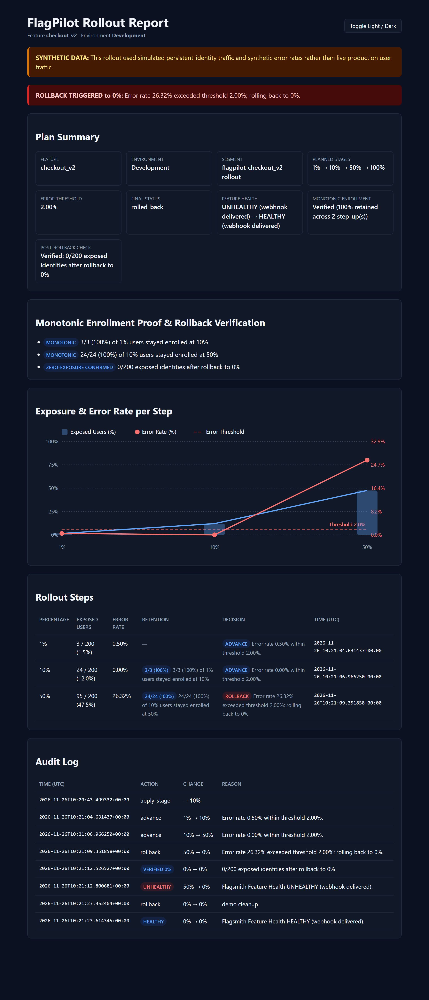
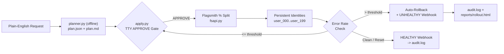

# FlagPilot



## The problem

Feature flag rollouts often jump straight from disabled to 100% or rely on ad-hoc dashboard clicks with no repeatable safety net. When an error spike hits mid-rollout, operators have to scramble to diagnose which cohort is affected and manually revert state without an audit trail. Self-hosted teams need a terminal-first workflow that plans percentage stages deterministically, enforces explicit human sign-off on every change, and rolls back automatically when error rates breach a threshold.

## The approach

FlagPilot orchestrates staged **% Split** (`PERCENTAGE_SPLIT`) rollouts on self-hosted Flagsmith through four safeguards:

1. **Zero-key deterministic planning (`planner.py`)**: A rule-based parser turns a plain-English rollout request into `plan.json` and `plan.md` with no LLM, no external API keys, and zero network calls by default. An optional thin `plan_with_llm()` adapter (enabled only via `--use-llm` or `FLAGPILOT_LLM_PROVIDER` + `GEMINI_API_KEY`/`OPENAI_API_KEY`) requests strict `Plan` JSON via standard-library `urllib.request`, validates through `plan_from_dict()`, falls back cleanly to the deterministic parser on error, and passes through the identical diff review and mandatory `APPROVE` gate.
2. **Mandatory human approval (`apply.py`)**: Every Flagsmith mutation requires an interactive TTY where the operator types exact `APPROVE`; non-interactive runs refuse and there is no `--auto-approve` or `--yes` flag. On `flagpilot run`, one upfront `APPROVE` authorizes the full stage schedule and safety policy so stages and emergency rollback execute automatically without mid-incident prompts (per-stage prompts remain opt-in via `--step-approve`).
3. **Stable persistent identities (`simulator.py`)**: Evaluations always supply persistent identities (`user_000`..`user_199` by default) because Flagsmith `% Split` hashing does not work on anonymous requests, with all simulated data labelled `SYNTHETIC DATA`.
4. **Deterministic rollback, monotonic proof & Rich UI (`controller.py`, `report.py`)**: Advances through configurable stages (default `1% -> 10% -> 50% -> 100%`) in a live `rich` rollout table (`--plain` for plain text), tracks exact exposed identity IDs per stage (`retained_from_previous_stage` monotonicity proof), automatically rolls back to the previous safe percentage or `0%` (`--rollback-to-zero`, default in demo runners) on error breach, runs a post-rollback `0/200` verification tick, notifies Flagsmith Grafana Feature Health (`FLAGSMITH_HEALTH_WEBHOOK_URL`) fail-safely (`UNHEALTHY` on rollback -> `HEALTHY` on completion/reset), logs every decision in UTC to `audit.log` without secrets, and renders `reports/rollout.html`.

## Architecture



```text
  Plain-English Request / CLI (cli.py)
        |
        +--> planner.py ----------> plan.json + plan.md (offline, zero-key; optional LLM adapter boundary)
        |
        +--> bootstrap.py --------> Zero-UI setup (superuser, org, project, env, keys, health webhook, .env)
        |
        +--> controller.py -------> audit.log (UTC decisions + feature_health events, no secrets)
        |       |
        |       +--> apply.py (TTY + exact "APPROVE" gate; refuses non-interactive)
        |       |       |
        |       |       v
        |       |    fsapi.py [FlagsmithClient / HealthNotifier] --(REST API + Webhook)--> Self-Hosted Flagsmith
        |       |
        |       +--> simulator.py (persistent user_000..; SYNTHETIC DATA)
        |               |
        |               +--> FlagsmithSDKEvaluator ---------(Python SDK + refresh)--> Self-Hosted Flagsmith
        |               +--> OfflineFakeEvaluator (unit tests / offline-only mode)
        |
        +--> report.py (reads audit.log + reports/last_run.json) --> reports/rollout.html (static, inline CSS+SVG)
```

### Why Flagsmith's `PERCENTAGE_SPLIT` Engine Is Load-Bearing (Deletion Test)

If you delete Flagsmith's `PERCENTAGE_SPLIT` segment rules and SDK evaluation from FlagPilot, production cohort bucketing stops working:

- FlagPilot stores the rollout rule (`operator: "PERCENTAGE_SPLIT"`, `property: null`, `value: "<pct>"`) in Flagsmith via `PUT /api/v1/projects/{project_id}/segments/{segment_id}/` and enables only the environment's segment override via `PATCH /api/__future__/environments/{env_key}/features/{feature_id}/` (leaving the global default `enabled: false`).
- On every rollout tick, `FlagsmithSDKEvaluator` calls `update_environment()` and `get_identity_flags(identifier=...)` against Flagsmith's engine so Flagsmith deterministically hashes each persistent identity (`user_000`..`user_199`), guaranteeing monotonic enrollment (`1% ⊆ 10% ⊆ 50% ⊆ 100%`) and immediate `0%` exposure on rollback. (`OfflineFakeEvaluator` exists solely for offline unit tests.)

### Targets

| Target | Command / File | Purpose |
| --- | --- | --- |
| `bootstrap` | `flagpilot bootstrap` | Zero-UI setup against `http://localhost:8000`; writes `.env` idempotently. |
| `plan` | `flagpilot plan "<request>"` | Parse request offline (`--use-llm` optional via `plan_with_llm()`), render Rich panel (`--plain` fallback), write `plan.json` + `plan.md`. |
| `apply` | `flagpilot apply plan.json` | Print plan, require exact `APPROVE`, and apply target percentage to Flagsmith. |
| `run` | `flagpilot run ...` | Require upfront policy `APPROVE` (`--step-approve` opt-in), render live table, verify monotonic retention, auto-roll back (`--rollback-to-zero`) + verify `0/200`, notify Feature Health. |
| `rollback` | `flagpilot rollback ...` | Gate and apply a `0%` rollback and disable segment override, logging to `audit.log`. |
| `report` | `flagpilot report` | Read `audit.log` and `reports/last_run.json` and render static `reports/rollout.html`. |
| Task runners | `scripts/demo`, `Makefile`, `tasks.ps1` | Cross-platform `up`, `bootstrap`, `down`, `test`, `lint`, `smoke`, and `demo`. |

### What makes this hard to break

| Failure Mode | How FlagPilot Handles It |
| --- | --- |
| **Unstable identities** | `load_or_create_identities()` generates and persists ordered IDs (`user_000..`), and `FlagsmithSDKEvaluator.evaluate()` rejects empty identifiers so `% Split` hashing stays consistent across stages. |
| **Writes without approval** | Every Flagsmith mutation routes through `ApprovedFlagsmithWriter` -> `require_approval()` in `apply.py`, which rejects non-TTY stdin and anything other than exact `APPROVE` with no bypass flag (including LLM-generated plans). |
| **Runaway rollout** | `RolloutController` stops advancing whenever observed error rate exceeds `max_error_rate` (default `2%`), automatically executes rollback to `0%` (with `--rollback-to-zero`) or previous safe stage, runs a post-rollback `0/200` exposure check, and sends a fail-safe `firing` (`UNHEALTHY`) Feature Health webhook. |
| **Unlabelled synthetic data** | `simulator.py`, `types.py`, `report.py`, and `cli.py` tag all simulated evaluations, metrics, summaries, and HTML/Markdown reports with `SYNTHETIC DATA`. |
| **Flagsmith unreachable** | `FlagsmithManagementClient` wraps `requests.RequestException` and HTTP errors into `FlagsmithAPIError` with sanitized response bodies (keys scrubbed to `[REDACTED]`); `plan`, `report`, and `OfflineFakeEvaluator` run offline. |

## Quickstart

Zero-click self-hosted setup and end-to-end demo (no browser UI clicks or manual `.env` copy required):

**macOS / Linux (`bash`):**
```bash
python3 -m venv .venv && .venv/bin/pip install -e ".[dev]"
docker compose up -d
.venv/bin/flagpilot bootstrap
bash scripts/demo
```

**Windows PowerShell:**
```powershell
python -m venv .venv; .venv\Scripts\pip.exe install -e ".[dev]"
docker compose up -d
.venv\Scripts\flagpilot.exe bootstrap
.\tasks.ps1 demo
```

During `scripts/demo` / `.\tasks.ps1 demo`, type `APPROVE` interactively when prompted (`apply`, one-shot upfront policy `APPROVE` for `run` with `--rollback-to-zero`, and cleanup `rollback` reset); after completion, open `reports/rollout.html` in any browser.

## Repository map

```text
.
├── .github/workflows/ci.yml         # GitHub Actions CI (ruff + offline pytest on Python 3.11 & 3.13)
├── pyproject.toml                   # Python >=3.11 packaging, deps (requests, python-dotenv, flagsmith, rich), pytest markers
├── docker-compose.yml               # Official self-hosted Flagsmith + Postgres compose stack
├── .env.example                     # Placeholder env vars (FLAGSMITH_API_URL, keys, project/feature/segment IDs)
├── .gitattributes                   # Enforces LF on *.sh, scripts/demo, Makefile; CRLF on *.ps1
├── .gitignore                       # Ignores .env, *.env.local, audit.log, reports/, .venv/, caches, build artifacts
├── Makefile                         # POSIX targets (help, install, test, lint, smoke, up, bootstrap, down, demo*)
├── tasks.ps1                        # Windows PowerShell tasks matching Makefile targets 1:1
├── scripts/
│   └── demo                         # Executable POSIX demo (ensures Flagsmith up, bootstraps .env if absent, runs demo)
├── docs/
│   ├── ARCHITECTURE.md              # Component design, safety boundaries, and data flow
│   ├── SELF_HOSTING.md              # Zero-click self-hosted Flagsmith setup & verification guide
│   └── assets/rollout-report.png    # Verified full-page screenshot of reports/rollout.html
├── src/flagpilot/
│   ├── types.py                     # Frozen dataclasses (Plan, Step, Decision) & FlagsmithClient Protocol
│   ├── bootstrap.py                 # Idempotent zero-UI Flagsmith bootstrap writing local .env
│   ├── planner.py                   # Offline zero-key plain-English parser, plan.json & plan.md generator
│   ├── apply.py                     # Interactive APPROVE gate & non-interactive refusal boundary
│   ├── fsapi.py                     # Flagsmith Management REST API client (verified against local Flagsmith 2.295.2)
│   ├── simulator.py                 # Persistent-identity SYNTHETIC DATA simulator & Flagsmith SDK wrapper
│   ├── controller.py                # Deterministic staged rollout state machine & UTC audit.log writer
│   ├── report.py                    # Static self-contained HTML + inline CSS/SVG report generator
│   └── cli.py                       # argparse CLI (bootstrap, plan, apply, run, rollback, report)
└── tests/
    ├── test_acceptance.py           # End-to-end feature acceptance tests (fakes/mocks)
    ├── test_bootstrap.py            # Mocked initial & idempotent rerun bootstrap tests
    ├── test_cli.py                  # CLI help, no-bypass, plan, bootstrap, and apply gate tests
    ├── test_controller.py           # Controller advancement, 50%->10% rollback, 0% rollback, audit log
    ├── test_fsapi_and_simulator.py  # Mocked Flagsmith REST & SDK tests + key-redaction tests
    ├── test_live_flagsmith.py       # @pytest.mark.live integration test (requires FLAGPILOT_LIVE_TEST=1)
    ├── test_planner.py              # Plain-English parser & planner import-isolation tests
    ├── test_report.py               # Static HTML/SVG report generation from fake run + audit.log
    └── test_simulator.py            # Persistent user_000.. identity & error-spike tests
```

## How I used Flagsmith

- **Self-hosted Flagsmith (`2.295.2`)**: Runs locally via `docker-compose.yml` (`http://localhost:8000`) and is provisioned without UI clicks by `flagpilot bootstrap` (`/health/liveness/`, `/version/`, `/api/v1/auth/users/`, `/api/v1/auth/login/`, `/api/v1/organisations/`, `/api/v1/organisations/{id}/master-api-keys/`, `/api/v1/environments/{client_key}/api-keys/`).
- **`% Split` (`PERCENTAGE_SPLIT`) segments**: Creates and updates project segments with `operator: "PERCENTAGE_SPLIT"`, `property: null`, and `value: "<percent>"` via `/api/v1/projects/{project_id}/segments/`.
- **Segment overrides (v1 & v2 compatible)**: Reads and patches segment overrides via `GET`/`PATCH /api/__future__/environments/{env_key}/features/{feature_id}/` so `environment_default.enabled` stays `false` while the rollout segment override is toggled cleanly across both Feature Versioning v1 and v2.
- **Stable persistent identities**: Evaluates every rollout round with the exact same ordered identities (`user_000`..`user_199`) via `Flagsmith.get_identity_flags(identifier=...)` with `enable_local_evaluation=True` and explicit `update_environment()` refresh per round.
- **REST Management API & Feature Health**: Uses `Authorization: Api-Key <FLAGSMITH_ADMIN_KEY>` directly via `requests` in `src/flagpilot/fsapi.py` (never using an MCP server or external LLM) and scrubs all secrets from error messages and logs. `flagpilot bootstrap` also idempotently provisions a `"Grafana"` Feature Health provider (`/api/v1/projects/{project_id}/feature-health/providers/`) as `FLAGSMITH_HEALTH_WEBHOOK_URL`; `controller.py` fail-safely POSTs Alertmanager JSON (`status: "firing"` on error-rate rollback -> Flagsmith shows `Unhealthy`; `status: "resolved"` on clean completion or manual reset -> `Healthy`).

## Development status

- **Unit CI (`pytest -v` & `ruff check src tests` via `.github/workflows/ci.yml`)**: `47` offline tests pass (`1` live test skipped unless `FLAGPILOT_LIVE_TEST=1`) and `ruff` passes with zero issues across Python `3.11` and `3.13`. Also supports `--plain` for deterministic plain-text CI logs alongside Rich terminal panels/tables.
- **Live Flagsmith integration (`FLAGPILOT_LIVE_TEST=1 pytest -m live -v`)**: Verified against live self-hosted Flagsmith `2.295.2` (`1 passed`), covering idempotent `bootstrap`, single upfront `APPROVE` policy gate, monotonic `1% -> 10% -> 50%` retention proof, automatic `0%` rollback + `0/200` post-rollback verification on fault spike, Grafana Feature Health `UNHEALTHY`/`HEALTHY` webhook delivery, `audit.log` recording, and static `reports/rollout.html`.
